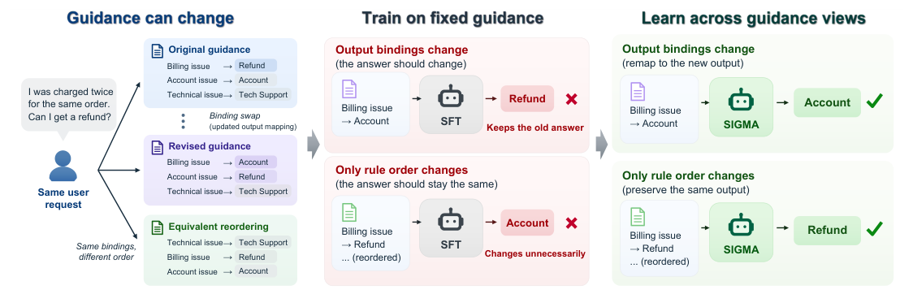
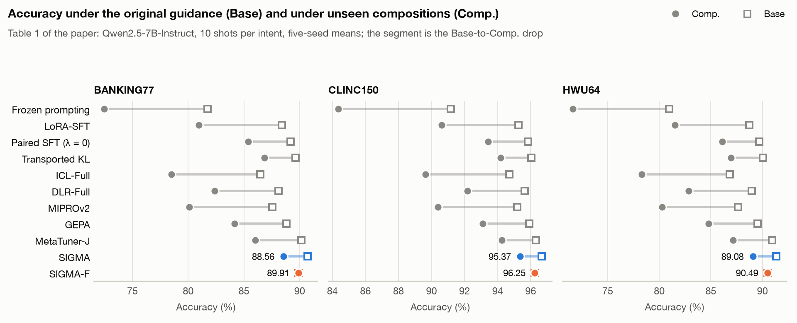
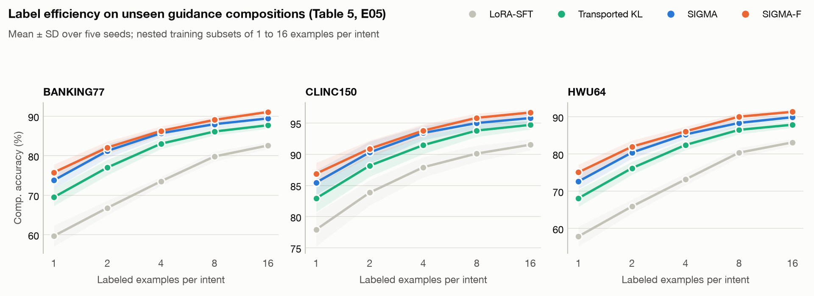
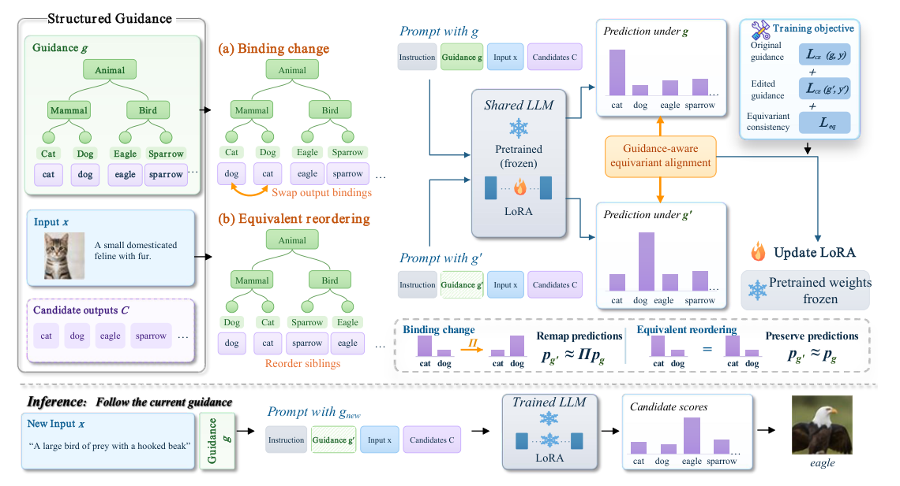
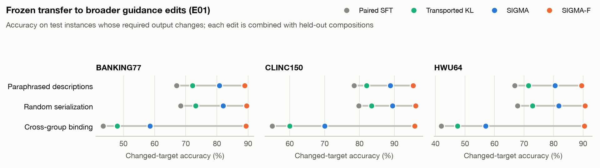
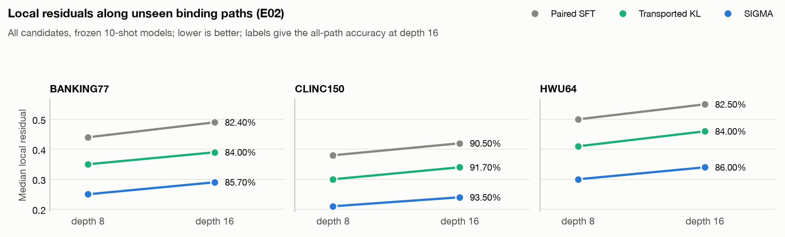
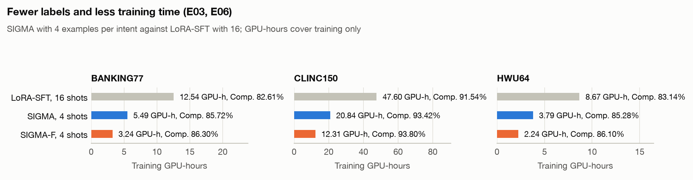
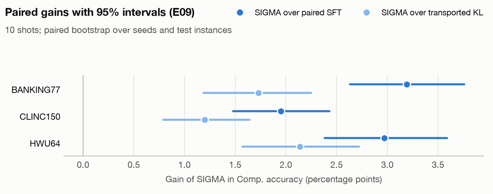
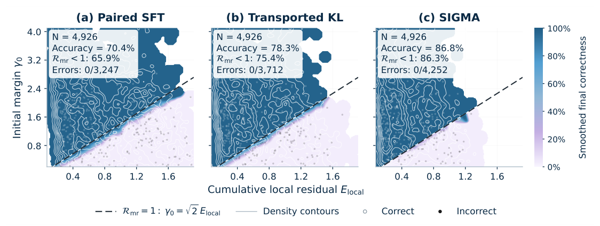

<h1 align="center">SIGMA</h1>

<p align="center">
  <b>Label-Efficient Training of Language Models to Follow Changing Structured Guidance</b><br>
  Official implementation of SIGMA (<b>S</b>tructured <b>I</b>nterventions for <b>G</b>uidance-aware <b>M</b>odel <b>A</b>daptation)
</p>

<p align="center">
  <a href="#citation"></a>
  <a href="pyproject.toml"></a>
  <a href="LICENSE"></a>
  <a href="https://github.com/OdurShi/sigma/actions/workflows/ci.yml"></a>
  <a href="https://github.com/astral-sh/ruff"></a>
</p>

<p align="center">
  <a href="#main-results">Main results</a> ·
  <a href="#quick-start">Quick start</a> ·
  <a href="#reproducing-the-paper">Reproduce</a> ·
  <a href="#supplementary-experiments">Supplementary experiments</a> ·
  <a href="#method-to-code-map">Code map</a>
</p>

<p align="center">
  
</p>

A model that answers correctly under one fixed task specification has not shown that it
*uses* the specification. SIGMA fine-tunes with, for every labeled input, the correct answer
under two versions of the guidance **and** the way the scores of all candidate outputs must
transform between them, so that the model follows the guidance when it changes.

## Highlights

- **Follows guidance edits it has never seen.** On unseen compositions of binding changes,
  SIGMA reaches 88.56 / 95.37 / 89.08% accuracy on BANKING77 / CLINC150 / HWU64, against
  80.96 / 90.61 / 81.54% for LoRA fine-tuning with the same 10 labels per intent (Table 1).
- **Changes the answer when the guidance requires it.** On test inputs whose required output
  changes, accuracy rises from 74.38 / 84.27 / 73.58% (transported KL) to
  83.18 / 90.42 / 83.23% (Table 12); all paired gains have 95% intervals above zero (Table 13).
- **Label-efficient.** With 4 labels per intent SIGMA exceeds 16-shot LoRA fine-tuning on
  every dataset (85.72 vs. 82.61, 93.42 vs. 91.54, 85.28 vs. 83.14% Comp. accuracy), with 75%
  fewer training labels and about 56% less training time (Table 5, E03).
- **Transfers beyond the training edits.** Frozen models keep their advantage under
  paraphrased descriptions, random serialisation and cross-group binding swaps (E01), and on
  binding paths of depth 16 (E02).
- **Reproducible from this repository.** Datasets, hierarchies, few-shot subsets, every
  experiment grid, the reported tables as CSV, and a CPU quick start are included.

## Main results

Results reported in the paper and in the supplementary experiments; the figures are drawn
from the CSV files in [`results/`](results) by `scripts/plot_results.py`.





**Table 1 of the paper.** Qwen2.5-7B-Instruct, 10 shots per intent, five-seed mean accuracy
(%). Base uses the original guidance; Comp. averages six held-out composition conditions.
SIGMA-F is the factorised variant with exact binding lookup (Appendix A.3).

<!-- table:T01 -->
| Method | BANKING77 Base | BANKING77 Comp. | CLINC150 Base | CLINC150 Comp. | HWU64 Base | HWU64 Comp. |
|---|---:|---:|---:|---:|---:|---:|
| Frozen prompting | 81.73 | 72.46 | 91.18 | 84.37 | 80.94 | 71.62 |
| LoRA-SFT | 88.41 | 80.96 | 95.27 | 90.61 | 88.73 | 81.54 |
| Paired SFT (λ = 0) | 89.18 | 85.37 | 95.84 | 93.42 | 89.71 | 86.11 |
| Transported KL | 89.62 | 86.83 | 96.03 | 94.17 | 90.06 | 86.94 |
| ICL-Full | 86.47 | 78.51 | 94.71 | 89.64 | 86.82 | 78.29 |
| DLR-Full | 88.09 | 82.36 | 95.63 | 92.18 | 88.97 | 82.84 |
| MIPROv2 | 87.54 | 80.11 | 95.19 | 90.38 | 87.63 | 80.27 |
| GEPA | 88.82 | 84.16 | 95.91 | 93.09 | 89.53 | 84.77 |
| MetaTuner-J | 90.17 | 86.02 | 96.31 | 94.26 | 90.92 | 87.15 |
| SIGMA | **90.71** | 88.56 | **96.68** | 95.37 | **91.34** | 89.08 |
| SIGMA-F | 89.91 | **89.91** | 96.25 | **96.25** | 90.49 | **90.49** |
<!-- /table:T01 -->

## Method

The task specification is a small tree of semantic groups and classes in which every class
is bound to an output string. Each labeled input is paired with an edited version of that
guidance whose effect on the answer is known:

* a **binding swap** exchanges the outputs of two sibling classes, so the required answer
  and, more generally, the whole score vector over candidate outputs must be permuted;
* a **reordering** of sibling rules changes the document but not its meaning, so the scores
  must stay the same.

The loss is the cross-entropy of the correct output under both versions plus a penalty on the
difference between the mean-centred candidate scores of the edited view and the permuted
scores of the original view (Eq. (5)). Only LoRA parameters are trained. At test time the
model scores every candidate under the current guidance; the paper evaluates unseen
*compositions* of several swaps with and without reordering.

<p align="center">
  
</p>

## Installation

Python 3.10 or newer. With [uv](https://docs.astral.sh/uv/):

```bash
git clone https://github.com/OdurShi/sigma.git && cd sigma
uv venv --python 3.11 .venv
uv pip install -p .venv/bin/python -e ".[dev]"            # library, tests, linter
uv pip install -p .venv/bin/python -e ".[data,plots]"     # label clustering, figures
```

With pip:

```bash
python -m venv .venv && source .venv/bin/activate
pip install -e ".[dev]"            # add ",data,plots" for label clustering and figures
```

The import package is `sigma`; the distribution is named `sigma-guidance`. The code is
developed against PyTorch 2.14–2.15, Transformers 5.20–5.23 and PEFT 0.21.

## Quick start

Trains single-view fine-tuning and SIGMA on a synthetic intent-routing task with a two-layer
Qwen2-style model that is built and randomly initialised in code. Nothing is downloaded and
no GPU is needed; it takes about two minutes on a laptop CPU.

```bash
sigma demo            # or: python examples/quickstart.py
```

Output (seed 13):

```text
[LoRA-SFT] 300 steps in 11s | loss 1.761 -> 0.023 | consistency term 0.0000 -> 0.0000 | selected step 180 (dev acc 0.875)
[SIGMA] 1600 steps in 103s | loss 1.786 -> 0.020 | consistency term 0.0153 -> 0.0012 | selected step 960 (dev acc 1.000)
    paired views: 25600 pairs, 4186 target-changing, 0 identity replacements

method                        Base      Rev.   Rev.Inv  Bind.Chg     Comp.  Comp.Chg   PairAcc  EquivAcc     TV_eq
------------------------------------------------------------------------------------------------------------------
LoRA-SFT                      95.8      77.1      79.2       3.3      29.2       3.4      27.8      28.2     0.691
SIGMA                         97.9      97.9     100.0      78.7      48.6      28.8      47.7      47.9     0.499

Accuracies in percent, TV_eq in [0, 1]. Comp. = unseen compositions of 2/4/8 binding swaps with and without reversal.
Setting: synthetic routing task, tiny randomly initialised model (configs/quickstart.yaml).
```

The columns are the metrics of the paper's evaluation protocol: accuracy under the base
guidance (`Base`), under the reversed document (`Rev.`, with prediction invariance
`Rev.Inv`), on single binding swaps that change the required answer (`Bind.Chg`), and on
unseen compositions of swaps (`Comp.`, `Comp.Chg`, `PairAcc`, `EquivAcc`, `TV_eq`).

`python examples/inspect_guidance.py` prints a guidance document, a binding swap, the
reordering and a composed edit without touching a model. The quick-start configuration is
`configs/quickstart.yaml`.

## Data

The three benchmarks of the paper are shipped in [`data/`](data), converted to JSONL with
the split sizes of Table 3, together with the task hierarchies, the rendered guidance
documents and the nested few-shot orderings for the seeds 13, 21, 42, 87 and 100.

| Dataset | Intents | Training pool | Development | Test | Hierarchy | Licence |
|---|---|---|---|---|---|---|
| BANKING77 | 77 | 8,622 | 1,540 | 3,080 | label clusters | CC BY 4.0 |
| CLINC150 | 150 | 15,000 | 3,000 | 4,500 | published domains | CC BY 3.0 |
| HWU64 | 64 | 8,954 | 1,076 | 1,076 | scenarios | CC BY 4.0 |

The loaders read these files by default (override with `--data-dir`, `data.directory` or the
environment variable `SIGMA_DATA_DIR`). [`data/README.md`](data/README.md) documents sources,
revisions, licences, file layout and checksums; `python scripts/prepare_data.py --dataset all`
rebuilds the folder from the upstream release.

## Reproducing the paper

The paper uses `Qwen/Qwen2.5-7B-Instruct` as the primary backbone and, for Figure 4,
`meta-llama/Meta-Llama-3-8B-Instruct` and `Qwen/Qwen3-8B`, on four NVIDIA A100 80 GB GPUs with
bfloat16 (Appendix C.5). All hyper-parameters of Appendix C.5 are the defaults of
[`configs/base.yaml`](configs/base.yaml). Every experiment is a grid file: `--dry-run` lists
its runs, `--only` selects cells and `--skip-existing` resumes.

<details>
<summary><b>Commands for every table and figure of the paper</b></summary>

| Paper item | Command | Config |
|---|---|---|
| Table 1, 4, 7, 11–14 | `python scripts/run_experiment.py --experiment configs/experiments/table1_main.yaml`, then `python scripts/make_tables.py --runs runs/table1_main --table 1` (or `4`, `7`, `11`, `12`, `13`, `14`) | [`table1_main.yaml`](configs/experiments/table1_main.yaml) |
| Table 2 | `python scripts/run_experiment.py --experiment configs/experiments/table2_ablations.yaml`, then `python scripts/make_tables.py --runs runs/table2_ablations --table 2` | [`table2_ablations.yaml`](configs/experiments/table2_ablations.yaml) |
| Table 5, Figure 5 | `python scripts/run_experiment.py --experiment configs/experiments/table5_label_efficiency.yaml`, then `python scripts/make_tables.py --runs runs/table5_label_efficiency --table 5` and `python scripts/make_figures.py figure5 --input runs/table5_label_efficiency --output fig5.pdf` | [`table5_label_efficiency.yaml`](configs/experiments/table5_label_efficiency.yaml) |
| Figure 4 | `python scripts/run_experiment.py --experiment configs/experiments/figure4_backbones.yaml`, then `python scripts/make_figures.py figure4 --input runs/figure4_backbones --output fig4.pdf` | [`figure4_backbones.yaml`](configs/experiments/figure4_backbones.yaml) |
| Table 10 | `python scripts/run_experiment.py --experiment configs/experiments/table10_opaque_outputs.yaml`, then `python scripts/make_tables.py --runs runs/table10_opaque_outputs --table 10` | [`table10_opaque_outputs.yaml`](configs/experiments/table10_opaque_outputs.yaml) |
| Figure 2, Table 9 | `python scripts/run_experiment.py --experiment configs/experiments/figure2_preliminary.yaml`, then `python scripts/preliminary_study.py --runs runs/figure2_preliminary --output prelim.json` and `python scripts/make_figures.py figure2 --input prelim.json --output fig2.pdf` | [`figure2_preliminary.yaml`](configs/experiments/figure2_preliminary.yaml) |
| Figure 6 | `python scripts/margin_residual.py --runs <paired_sft run> <transported_kl run> <sigma run> --output mr.json`, then `python scripts/make_figures.py figure6 --input mr.json --output fig6.pdf` | runs of `table1_main.yaml` |
| Figure 7 | `python scripts/spectral_contraction.py --method <sigma run> --reference <paired_sft run> --output spectral.json`, then `python scripts/make_figures.py figure7 --input spectral.json --output fig7.pdf` | runs of `table1_main.yaml` |
| Figure 8 | `python scripts/lora_knockout.py --run <sigma run> --output knockout.json`, then `python scripts/make_figures.py figure8 --input knockout.json --output fig8.pdf` | runs of `table1_main.yaml` |
| Table 3 | `python scripts/prepare_data.py --dataset all` | [`data/README.md`](data/README.md) |

</details>

A single run:

```bash
sigma train --config configs/base.yaml --set data.name=banking77 method=sigma seed=13 output_dir=runs/example
```

Methods are selected with `method=`: `frozen`, `sft`, `sft_token_matched`, `paired_sft`,
`transported_kl`, `sigma`, `sigma_binding_only`, `sigma_reversal_only`, `sigma_f`, and the controls of the
supplementary experiments `pbm_adapted`, `global_aug_paired`, `global_aug_sigma`.
[`configs/experiments/smoke_tiny.yaml`](configs/experiments/smoke_tiny.yaml) runs the same
grid machinery on CPU with the tiny model, and
[`configs/reduced_scale/`](configs/reduced_scale) holds a laptop-scale configuration with a
0.5B backbone.

## Supplementary experiments

Nine supplementary experiments (E01-E09) extend the paper's tables. They are results
reported by the authors; the numbers are stored as CSV files in
[`results/supplementary/`](results/supplementary/README.md), all nine tables with their setup
and key findings are in [docs/supplementary_results.md](docs/supplementary_results.md), and
`sigma.supplementary` checks them against each other and against the tables of the paper.

**E01: frozen transfer to broader guidance edits.**



**E02: local residuals of the composition bound on unseen binding paths.**



**E03, E06: labels and training time.**



**E05: SIGMA and the factorised variant SIGMA-F across label budgets** (Comp. accuracy,
mean ± SD).

<!-- table:E05 -->
| Dataset | Method | 1 shot | 2 shots | 4 shots | 8 shots | 16 shots |
|---|---|---:|---:|---:|---:|---:|
| BANKING77 | SIGMA | 73.81 ± 2.13 | 81.26 ± 1.75 | 85.72 ± 1.13 | 88.01 ± 0.96 | 89.47 ± 0.76 |
| BANKING77 | SIGMA-F | 75.80 ± 2.00 | 82.10 ± 1.55 | 86.30 ± 1.18 | 89.10 ± 0.86 | 91.10 ± 0.62 |
| CLINC150 | SIGMA | 85.47 ± 1.96 | 90.31 ± 1.75 | 93.42 ± 1.12 | 95.01 ± 0.98 | 95.81 ± 0.74 |
| CLINC150 | SIGMA-F | 86.90 ± 1.75 | 90.90 ± 1.30 | 93.80 ± 1.00 | 95.85 ± 0.70 | 96.70 ± 0.48 |
| HWU64 | SIGMA | 72.65 ± 1.97 | 80.41 ± 1.60 | 85.28 ± 1.30 | 88.37 ± 1.03 | 89.91 ± 0.79 |
| HWU64 | SIGMA-F | 75.10 ± 2.10 | 82.00 ± 1.65 | 86.10 ± 1.28 | 90.05 ± 0.92 | 91.35 ± 0.62 |
<!-- /table:E05 -->

**E09: paired gains with 95% intervals.**

<p align="center">
  
</p>

<details>
<summary><b>E04, E07, E08: time caps and related-method controls</b></summary>

E04: equal training-time caps on BANKING77 (10 shots).

<!-- table:E04 -->
| Method | 7.84 GPU-h cap: Comp. (%) | 13.73 GPU-h cap: actual GPU-h / Comp. (%) |
|---|---:|---:|
| LoRA-SFT | 80.96 | 13.51 / 80.43 |
| Paired SFT | 82.10 | 13.18 / 85.37 |
| Transported KL | 83.45 | 13.46 / 86.83 |
| SIGMA | 85.90 | 13.73 / 88.56 |
| SIGMA-F | 89.50 | 8.11 / 89.91 |
<!-- /table:E04 -->

E07: a PBM-LoRA-style permutation-consistency control (10 shots).

<!-- table:E07 -->
| Dataset | KL Comp. | PBM-adapted Comp. | SIGMA Comp. | PBM-adapted Changed | SIGMA Changed |
|---|---:|---:|---:|---:|---:|
| BANKING77 | 86.83 | 87.55 | 88.56 | 77.00 | 83.18 |
| CLINC150 | 94.17 | 94.70 | **95.37** | 86.00 | 90.42 |
| HWU64 | 86.94 | 87.55 | 89.08 | 76.00 | 83.23 |
<!-- /table:E07 -->

E08: Symbol-Tuning-style global binding augmentation, with and without SIGMA alignment.

<!-- table:E08 -->
| Dataset | Global binding augmentation + paired CE | Same augmentation + SIGMA alignment | Gain (pp) |
|---|---:|---:|---:|
| BANKING77 | 86.85 | 88.10 | +1.25 |
| CLINC150 | 93.95 | 94.95 | +1.00 |
| HWU64 | 86.50 | 88.20 | +1.70 |
<!-- /table:E08 -->

</details>

<details>
<summary><b>Commands and code for E01-E09</b></summary>

| ID | What | Command | Config / code |
|---|---|---|---|
| E01 | Random child orders and cross-group binding swaps appended to held-out compositions; paraphrased descriptions | `python scripts/run_experiment.py --experiment configs/experiments/supp_e01_broader_edits.yaml` (add `--set data.description_file=<paraphrases.json>` for the paraphrase condition) | [`supp_e01_broader_edits.yaml`](configs/experiments/supp_e01_broader_edits.yaml); `CrossGroupSwap`, `RandomOrder`, `EvalPlan.transfer`, `with_descriptions` |
| E02 | Median path-average local residual and all-path accuracy at depth 8 and 16, all candidates | `python scripts/margin_residual.py --runs <paired_sft run> <transported_kl run> <sigma run> --output e02.json --depths 8 16 --num-candidates all --all-paths` | `analysis.margin_residual_study`, `diagnostics.path_residual_summary` |
| E03, E06 | Training labels and training GPU-hours of SIGMA-4, SIGMA-F-4 and SFT-16 | runs of `table5_label_efficiency.yaml`; `selection.selected.gpu_hours` in `results.json` | `Trainer` (`training_seconds`, `gpu_hours`), `optim.num_gpus` |
| E04 | Equal training-time caps | `python scripts/run_experiment.py --experiment configs/experiments/supp_e04_time_caps.yaml` | [`supp_e04_time_caps.yaml`](configs/experiments/supp_e04_time_caps.yaml); `optim.max_gpu_hours` |
| E05 | SIGMA-F over the 1/2/4/8/16-shot budgets | `python scripts/run_experiment.py --experiment configs/experiments/table5_label_efficiency.yaml --only method=sigma_f` | [`table5_label_efficiency.yaml`](configs/experiments/table5_label_efficiency.yaml) |
| E07 | PBM-LoRA-style control with paired cross-entropy | `python scripts/run_experiment.py --experiment configs/experiments/supp_e07_pbm_adapted.yaml` | [`supp_e07_pbm_adapted.yaml`](configs/experiments/supp_e07_pbm_adapted.yaml); `losses.pbm_consistency` |
| E08 | Global random rebinding of opaque outputs, with and without alignment | `python scripts/run_experiment.py --experiment configs/experiments/supp_e08_global_binding.yaml` | [`supp_e08_global_binding.yaml`](configs/experiments/supp_e08_global_binding.yaml); `GlobalRebinding` |
| E09 | Paired gains and changed-target gains | `python scripts/make_tables.py --runs runs/table1_main --table 13` (and `--table 12`) | `evaluation/report.py` |

</details>

## Method-to-code map

| Paper | Code |
|---|---|
| Task record, guidance, fixed orders (Sec. 4.1, App. A.1) | `src/sigma/guidance/schema.py`: `TaskRecord`, `Guidance` |
| Serialisation and prompt `Render(x, C, g)` | `src/sigma/guidance/render.py`: `render_guidance`, `parse_guidance`, `render_prompt` |
| Eq. (1) binding swap, reversal, identity replacement, Eq. (A.1), (A.2), `G_train`, compositions | `src/sigma/guidance/edits.py`: `BindingSwap`, `Reversal`, `apply_edit`, `sample_binding_edit`, `target_change_probability`, `train_support_keys`, `apply_sequence` |
| Eq. (3) candidate scoring | `src/sigma/scoring/scorer.py`: `CandidateScorer.score` |
| Eq. (2), (4), (5) and the transported-KL control | `src/sigma/losses.py`: `transport`, `center_scores`, `paired_loss`, `transported_kl` |
| Eq. (6), App. A.2 optimisation procedure, App. C.5 settings | `src/sigma/training/trainer.py`: `Trainer`, `num_training_steps`, `checkpoint_steps` |
| Model selection (App. A.2 step 7, C.5) | `src/sigma/pipeline.py`: `train_with_selection`, `select_trial` |
| LoRA, knockout Eq. (D.6) | `src/sigma/models.py`: `apply_lora`, `lora_knockout` |
| SIGMA-F, Eq. (A.3) | `src/sigma/predictors.py`: `FactorizedPredictor` |
| Methods of Tables 1 and 2 | `src/sigma/methods.py`: `METHODS` |
| Benchmarks, few-shot subsets, hierarchies (App. C.1, C.2) | `src/sigma/data/datasets.py`, `fewshot.py`, `hierarchy.py` |
| Test guidance, acceptance (App. C.2) | `src/sigma/evaluation/protocol.py`: `ViewPlanner` |
| Eq. (C.1)–(C.3), accuracy, macro-F1, Hit@K, MRR, AULC, bootstrap | `src/sigma/evaluation/metrics.py` |
| Base/Comp. aggregation (App. C.6) | `src/sigma/evaluation/aggregate.py`: `summarize` |
| Eq. (7), (D.1)–(D.5), (D.7), (D.8), (C.5)–(C.10) | `src/sigma/evaluation/diagnostics.py`, `src/sigma/analysis.py` |
| Supplementary experiments E01-E08 | `guidance/edits.py`: `CrossGroupSwap`, `RandomOrder`, `GlobalRebinding`; `losses.py`: `pbm_consistency`; `evaluation/protocol.py`: `EvalPlan.transfer`; `training/trainer.py`: time cap and GPU-hours |
| Fixed-feature proxy, Thm. 4.1, Eq. (B.6)–(B.8), (B.16), (B.38) | `src/sigma/theory.py` |

The complete map and the implementation choices for details the paper leaves open are in
[`docs/implementation_notes.md`](docs/implementation_notes.md).

## Full results

The tables and figures in this section are the results reported in the paper.

<details>
<summary><b>Table 2: guidance-use diagnostics and ablations</b></summary>

Qwen2.5-7B-Instruct at 10 shots; equal-weight means over the three datasets. Accuracy in
percent, TV_eq in [0, 1] (lower is better).

<!-- table:T02 -->
| Variant | Binding swaps: Chg. Acc. | Binding swaps: PairAcc | Compositions: Chg. Acc. | Compositions: PairAcc | EquivAcc | TV_eq |
|---|---:|---:|---:|---:|---:|---:|
| SFT (token-matched) | 61.37 | 83.16 | 52.44 | 74.21 | 72.84 | 0.1487 |
| Paired SFT (λ = 0) | 81.26 | 88.91 | 73.18 | 83.72 | 87.61 | 0.0719 |
| Transported KL | 84.11 | 89.83 | 77.41 | 85.73 | 91.28 | 0.0424 |
| SIGMA: binding only | 88.76 | 91.22 | 82.18 | 86.73 | 92.88 | 0.0321 |
| SIGMA: reversal only | 62.41 | 84.69 | 55.87 | 78.83 | 84.31 | 0.0875 |
| SIGMA | 89.67 | 92.03 | 85.61 | 89.14 | 95.58 | 0.0189 |
| SIGMA-F | **92.18** | **92.21** | **92.09** | **92.22** | **100.00** | **0.0000** |
<!-- /table:T02 -->

</details>

<details>
<summary><b>Table 5: label efficiency across nested annotation budgets</b></summary>

<!-- table:T05 -->
| Dataset | Method | View | b = 1 | b = 2 | b = 4 | b = 8 | b = 16 | AULC |
|---|---|---|---:|---:|---:|---:|---:|---:|
| BANKING77 | LoRA-SFT | Base | 72.84 ± 2.27 | 79.65 ± 1.59 | 84.72 ± 1.21 | 87.63 ± 1.01 | 89.46 ± 0.67 | 83.29 ± 0.64 |
| BANKING77 | LoRA-SFT | Comp. | 59.71 ± 2.63 | 66.82 ± 1.83 | 73.54 ± 1.10 | 79.83 ± 1.28 | 82.61 ± 0.85 | 72.84 ± 0.57 |
| BANKING77 | Paired SFT | Base | 75.91 ± 1.66 | 82.34 ± 1.40 | 86.71 ± 1.47 | 88.66 ± 0.78 | 90.11 ± 0.84 | 85.18 ± 0.90 |
| BANKING77 | Paired SFT | Comp. | 67.83 ± 1.94 | 75.46 ± 1.48 | 81.94 ± 1.17 | 84.79 ± 1.06 | 86.48 ± 1.05 | 79.84 ± 0.53 |
| BANKING77 | Transported KL | Base | 76.88 ± 2.12 | 83.12 ± 1.39 | 87.29 ± 1.19 | 89.11 ± 0.91 | 90.38 ± 0.66 | 85.79 ± 0.73 |
| BANKING77 | Transported KL | Comp. | 69.52 ± 2.19 | 77.04 ± 1.94 | 83.06 ± 1.30 | 86.15 ± 0.97 | 87.74 ± 0.85 | 81.22 ± 0.73 |
| BANKING77 | SIGMA | Base | 79.64 ± 1.81 | 85.07 ± 1.39 | 88.52 ± 1.19 | 90.18 ± 0.80 | 91.27 ± 0.55 | 87.31 ± 0.60 |
| BANKING77 | SIGMA | Comp. | 73.81 ± 2.13 | 81.26 ± 1.75 | 85.72 ± 1.13 | 88.01 ± 0.96 | 89.47 ± 0.76 | 84.16 ± 0.55 |
| CLINC150 | LoRA-SFT | Base | 86.42 ± 2.02 | 90.34 ± 1.79 | 93.18 ± 1.17 | 94.83 ± 0.98 | 96.02 ± 0.53 | 92.39 ± 0.68 |
| CLINC150 | LoRA-SFT | Comp. | 77.93 ± 2.68 | 83.86 ± 2.03 | 87.92 ± 1.60 | 90.12 ± 1.28 | 91.54 ± 0.85 | 86.66 ± 0.79 |
| CLINC150 | Paired SFT | Base | 87.91 ± 1.96 | 91.82 ± 1.44 | 94.21 ± 1.26 | 95.46 ± 0.92 | 96.31 ± 0.68 | 93.40 ± 0.51 |
| CLINC150 | Paired SFT | Comp. | 81.76 ± 2.22 | 87.12 ± 1.73 | 90.66 ± 1.52 | 93.06 ± 1.02 | 94.11 ± 0.74 | 89.69 ± 0.60 |
| CLINC150 | Transported KL | Base | 88.54 ± 1.67 | 92.33 ± 1.33 | 94.62 ± 1.17 | 95.73 ± 0.81 | 96.42 ± 0.66 | 93.79 ± 0.55 |
| CLINC150 | Transported KL | Comp. | 82.94 ± 2.18 | 88.18 ± 1.75 | 91.47 ± 1.40 | 93.81 ± 1.00 | 94.72 ± 0.72 | 90.57 ± 0.51 |
| CLINC150 | SIGMA | Base | 89.76 ± 1.59 | 93.51 ± 1.25 | 95.43 ± 1.11 | 96.31 ± 0.78 | 97.01 ± 0.55 | 94.66 ± 0.52 |
| CLINC150 | SIGMA | Comp. | 85.47 ± 1.96 | 90.31 ± 1.75 | 93.42 ± 1.12 | 95.01 ± 0.98 | 95.81 ± 0.74 | 92.34 ± 0.56 |
| HWU64 | LoRA-SFT | Base | 70.93 ± 2.22 | 78.84 ± 1.75 | 84.17 ± 1.46 | 87.96 ± 0.91 | 89.77 ± 0.77 | 82.83 ± 0.70 |
| HWU64 | LoRA-SFT | Comp. | 57.88 ± 2.66 | 65.93 ± 1.84 | 73.19 ± 1.54 | 80.37 ± 1.26 | 83.14 ± 0.94 | 72.50 ± 0.76 |
| HWU64 | Paired SFT | Base | 74.12 ± 2.10 | 81.36 ± 1.49 | 86.29 ± 1.19 | 89.09 ± 0.80 | 90.42 ± 0.61 | 84.75 ± 0.54 |
| HWU64 | Paired SFT | Comp. | 66.47 ± 2.02 | 74.98 ± 1.85 | 81.35 ± 1.59 | 85.63 ± 1.11 | 87.02 ± 0.81 | 79.68 ± 0.58 |
| HWU64 | Transported KL | Base | 75.26 ± 1.80 | 82.08 ± 1.53 | 86.94 ± 1.29 | 89.52 ± 0.88 | 90.69 ± 0.60 | 85.38 ± 0.51 |
| HWU64 | Transported KL | Comp. | 68.13 ± 2.27 | 76.22 ± 1.73 | 82.44 ± 1.33 | 86.51 ± 1.16 | 87.89 ± 0.80 | 80.80 ± 0.58 |
| HWU64 | SIGMA | Base | 78.31 ± 1.65 | 84.07 ± 1.32 | 88.22 ± 1.06 | 90.66 ± 0.80 | 91.81 ± 0.55 | 87.00 ± 0.44 |
| HWU64 | SIGMA | Comp. | 72.65 ± 1.97 | 80.41 ± 1.60 | 85.28 ± 1.30 | 88.37 ± 1.03 | 89.91 ± 0.79 | 83.83 ± 0.67 |
<!-- /table:T05 -->

</details>

<details>
<summary><b>Table 8: computational cost and inference latency</b></summary>

<!-- table:T08 -->
| Method | Trainable params (M) | GPU-h | Peak GiB | Processed tokens (M) | Auxiliary tokens (M) | Latency p50 / p95 (ms) |
|---|---:|---:|---:|---:|---:|---:|
| LoRA-SFT | 40.42 | 7.84 | 58.60 | 107.84 | 0.00 | 684 / 793 |
| SFT (token-matched) | 40.42 | 13.51 | 58.80 | 199.42 | 0.00 | 687 / 799 |
| Paired SFT | 40.42 | 13.18 | 59.40 | 196.87 | 0.00 | 690 / 804 |
| Transported KL | 40.42 | 13.46 | 59.70 | 197.11 | 0.00 | 691 / 806 |
| ICL-Full | 0.00 | 0.61 | 33.80 | 41.28 | 0.00 | 1018 / 1267 |
| DLR-Full | 0.00 | 1.93 | 38.40 | 46.17 | 18.62 | 1186 / 1479 |
| MIPROv2 | 0.00 | 17.62 | 70.40 | 271.86 | 93.41 | 721 / 853 |
| GEPA | 0.00 | 21.47 | 71.00 | 314.58 | 127.63 | 735 / 871 |
| MetaTuner-J | 112.64 | 26.84 | 74.30 | 232.47 | 156.28 | 789 / 1016 |
| SIGMA-F | 40.42 | 8.11 | 57.90 | 123.08 | 0.00 | 675 / 786 |
| SIGMA | 40.42 | 13.73 | 59.80 | 197.33 | 0.00 | 688 / 797 |
<!-- /table:T08 -->

</details>

<details>
<summary><b>Tables 11-13: matched support, responses to edits, paired differences</b></summary>

<!-- table:T11 -->
| Dataset | Method | Matched Base | Comp. | Paired drop |
|---|---|---:|---:|---:|
| BANKING77 | LoRA-SFT | 88.39 ± 0.86 | 80.96 ± 1.12 | 7.43 ± 0.71 |
| BANKING77 | SFT (token-matched) | 88.72 ± 0.79 | 80.43 ± 1.17 | 8.29 ± 0.76 |
| BANKING77 | Paired SFT | 89.16 ± 0.79 | 85.37 ± 1.05 | 3.79 ± 0.61 |
| BANKING77 | Transported KL | 89.60 ± 0.81 | 86.83 ± 0.91 | 2.77 ± 0.52 |
| BANKING77 | SIGMA-F | 89.91 ± 0.72 | 89.91 ± 0.72 | 0.00 ± 0.00 |
| BANKING77 | SIGMA | 90.70 ± 0.73 | 88.56 ± 0.87 | 2.14 ± 0.48 |
| CLINC150 | LoRA-SFT | 95.26 ± 0.74 | 90.61 ± 1.08 | 4.65 ± 0.49 |
| CLINC150 | SFT (token-matched) | 95.39 ± 0.68 | 90.22 ± 1.11 | 5.17 ± 0.55 |
| CLINC150 | Paired SFT | 95.83 ± 0.72 | 93.42 ± 0.91 | 2.41 ± 0.38 |
| CLINC150 | Transported KL | 96.02 ± 0.70 | 94.17 ± 0.86 | 1.85 ± 0.31 |
| CLINC150 | SIGMA-F | 96.25 ± 0.56 | 96.25 ± 0.56 | 0.00 ± 0.00 |
| CLINC150 | SIGMA | 96.67 ± 0.67 | 95.37 ± 0.82 | 1.30 ± 0.27 |
| HWU64 | LoRA-SFT | 88.71 ± 0.82 | 81.54 ± 1.10 | 7.17 ± 0.68 |
| HWU64 | SFT (token-matched) | 88.96 ± 0.77 | 80.88 ± 1.15 | 8.08 ± 0.74 |
| HWU64 | Paired SFT | 89.69 ± 0.75 | 86.11 ± 0.98 | 3.58 ± 0.57 |
| HWU64 | Transported KL | 90.04 ± 0.73 | 86.94 ± 0.90 | 3.10 ± 0.51 |
| HWU64 | SIGMA-F | 90.49 ± 0.68 | 90.49 ± 0.68 | 0.00 ± 0.00 |
| HWU64 | SIGMA | 91.32 ± 0.69 | 89.08 ± 0.86 | 2.24 ± 0.46 |
<!-- /table:T11 -->

<!-- table:T12 -->
| Dataset | Method | Changed: Acc. | Changed: PairAcc | Unchanged: Acc. | Unchanged: PairAcc | Reversal: Acc. | Reversal: Inv. |
|---|---|---:|---:|---:|---:|---:|---:|
| BANKING77 | Paired SFT | 69.70 ± 1.42 | 67.80 ± 1.51 | 87.34 ± 0.92 | 82.39 ± 1.06 | 89.26 ± 0.81 | 95.12 ± 0.74 |
| BANKING77 | Transported KL | 74.38 ± 1.31 | 72.60 ± 1.38 | 88.39 ± 0.88 | 84.59 ± 0.97 | 89.67 ± 0.79 | 96.42 ± 0.61 |
| BANKING77 | SIGMA-F | 89.54 ± 0.77 | 89.54 ± 0.77 | 89.96 ± 0.71 | 89.96 ± 0.71 | 89.87 ± 0.70 | 100.00 ± 0.00 |
| BANKING77 | SIGMA | 83.18 ± 1.02 | 81.95 ± 1.08 | 89.24 ± 0.80 | 87.50 ± 0.88 | 90.78 ± 0.73 | 98.61 ± 0.34 |
| CLINC150 | Paired SFT | 80.85 ± 1.12 | 78.70 ± 1.18 | 94.22 ± 0.78 | 89.47 ± 0.91 | 95.77 ± 0.71 | 97.36 ± 0.52 |
| CLINC150 | Transported KL | 84.27 ± 0.98 | 82.65 ± 1.03 | 94.80 ± 0.73 | 91.13 ± 0.81 | 96.07 ± 0.68 | 98.08 ± 0.43 |
| CLINC150 | SIGMA-F | 96.13 ± 0.57 | 96.13 ± 0.57 | 96.26 ± 0.55 | 96.26 ± 0.55 | 96.22 ± 0.56 | 100.00 ± 0.00 |
| CLINC150 | SIGMA | 90.42 ± 0.82 | 89.35 ± 0.87 | 95.69 ± 0.66 | 94.15 ± 0.73 | 96.64 ± 0.64 | 99.16 ± 0.23 |
| HWU64 | Paired SFT | 68.99 ± 1.55 | 66.60 ± 1.64 | 88.72 ± 0.95 | 83.87 ± 1.08 | 89.73 ± 0.79 | 94.84 ± 0.82 |
| HWU64 | Transported KL | 73.58 ± 1.42 | 71.80 ± 1.50 | 88.98 ± 0.89 | 85.08 ± 0.99 | 90.09 ± 0.76 | 96.11 ± 0.65 |
| HWU64 | SIGMA-F | 90.60 ± 0.72 | 90.60 ± 0.72 | 90.47 ± 0.67 | 90.47 ± 0.67 | 90.53 ± 0.68 | 100.00 ± 0.00 |
| HWU64 | SIGMA | 83.23 ± 1.11 | 81.70 ± 1.18 | 89.97 ± 0.82 | 87.44 ± 0.91 | 91.39 ± 0.70 | 98.47 ± 0.37 |
<!-- /table:T12 -->

<!-- table:T13 -->
| Comparator | Quantity / shots | BANKING77 | CLINC150 | HWU64 |
|---|---|---:|---:|---:|
| LoRA-SFT | Comp., 10 vs. 10 | +7.60 [6.91, 8.33] | +4.76 [4.18, 5.37] | +7.54 [6.78, 8.28] |
| SFT (token-matched) | Comp., 10 vs. 10 | +8.13 [7.36, 8.91] | +5.15 [4.51, 5.79] | +8.20 [7.39, 9.03] |
| Paired SFT | Comp., 10 vs. 10 | +3.19 [2.63, 3.76] | +1.95 [1.48, 2.43] | +2.97 [2.38, 3.59] |
| Transported KL | Comp., 10 vs. 10 | +1.73 [1.19, 2.25] | +1.20 [0.79, 1.64] | +2.14 [1.57, 2.72] |
| LoRA-SFT | Comp., 4 vs. 16 | +3.11 [2.22, 4.03] | +1.88 [1.16, 2.63] | +2.14 [1.20, 3.11] |
| LoRA-SFT | Comp. AULC | +11.32 [10.77, 11.89] | +5.68 [5.17, 6.20] | +11.33 [10.75, 11.93] |
| Paired SFT | Comp. AULC | +4.32 [3.83, 4.83] | +2.65 [2.24, 3.06] | +4.15 [3.63, 4.68] |
| Transported KL | Comp. AULC | +2.94 [2.49, 3.41] | +1.77 [1.40, 2.15] | +3.03 [2.56, 3.52] |
<!-- /table:T13 -->

</details>

**Figure 5 of the paper:** composition accuracy against the number of unique training labels.


**Figure 4 of the paper:** Base and Comp. accuracy of LoRA-SFT, paired SFT and SIGMA on three
backbones at 5 and 10 shots per intent.


**Figure 6 of the paper:** margin–residual score diagnostic for paired SFT, transported KL
and SIGMA.



All figures of the paper, with their captions, are in
[`assets/paper_figures/`](assets/paper_figures). Example outputs of the reduced-scale
configuration are in [`results/reduced_scale/`](results/reduced_scale).

## Repository structure

```text
assets/paper_figures/        figures of the paper and their captions
assets/results/              figures drawn from the reported tables
configs/
  base.yaml                  paper defaults (Appendix C.5)
  datasets/ backbones/       include files used by the experiment grids
  experiments/               one grid per table/figure, plus a CPU smoke test
  quickstart.yaml            the configuration of `sigma demo`
  reduced_scale/             laptop-scale configuration with a 0.5B backbone
data/                        BANKING77, CLINC150, HWU64 with hierarchies and few-shot orderings
docs/implementation_notes.md paper-to-code map and implementation choices
docs/supplementary_results.md the nine supplementary tables (generated)
examples/                    quick start and guidance inspection
results/paper/               Tables 1, 2, 5, 8, 11, 12, 13 of the paper as CSV
results/supplementary/       reported tables E01-E09 as CSV, with index.yaml
results/reduced_scale/       example outputs of the reduced-scale configuration
scripts/                     data preparation, experiment runner, tables, figures, diagnostics
src/sigma/
  guidance/                  task records, serialisation, edit operators and sampling laws
  scoring/                   tokenisation at the answer boundary, candidate scorer
  losses.py                  the SIGMA objective and its controls
  training/                  optimisation procedure
  evaluation/                test-guidance protocol, metrics, aggregation, diagnostics, tables
  data/                      few-shot sampling, hierarchies, dataset loaders, synthetic task
  supplementary.py           loader, renderer and consistency checks for the reported tables
  methods.py models.py predictors.py pipeline.py analysis.py theory.py config.py cli.py demo.py
tests/                       unit tests per equation-level component and end-to-end tests
```

## Citation

The paper is under review. The BibTeX entry will be added here on publication.

## License

The code is released under the MIT license, see [LICENSE](LICENSE). The datasets in `data/`
keep their own licences (CC BY 4.0 and CC BY 3.0), see [`data/README.md`](data/README.md).

## Acknowledgements

* Datasets: BANKING77 (Casanueva et al., 2020), CLINC150 (Larson et al., 2019) and HWU64
  (Liu et al., 2021), in the splits of the public few-shot intent-detection release used by
  CPFT and QAID.
* Models: Qwen2.5 and Qwen3 (Apache-2.0), Llama 3 (Meta Llama 3 Community License),
  all-mpnet-base-v2 (Apache-2.0).
* Libraries: PyTorch, Hugging Face Transformers and PEFT.
