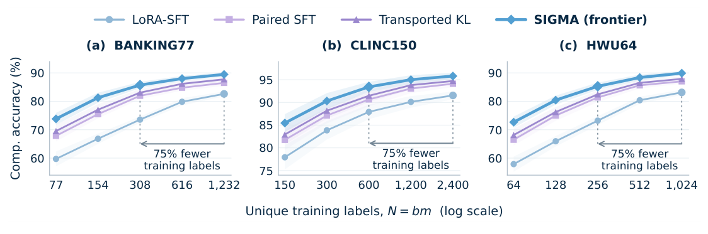
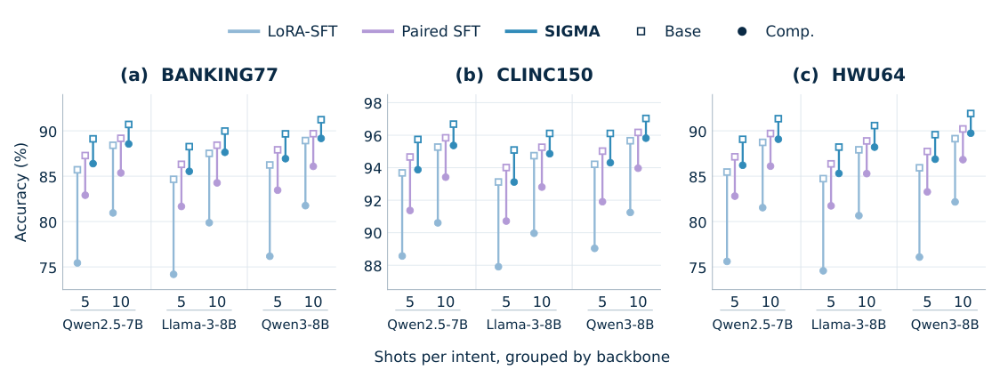

# SIGMA: Label-Efficient Training of Language Models to Follow Changing Structured Guidance

Official implementation of SIGMA (**S**tructured **I**nterventions for **G**uidance-aware
**M**odel **A**daptation): fine-tuning that supervises, for every labeled input, the correct
answer under two versions of the guidance *and* how the scores of all candidate outputs must
transform between them.

[](#citation)
[](pyproject.toml)
[](LICENSE)
[](https://github.com/OdurShi/sigma/actions/workflows/ci.yml)
[](https://github.com/astral-sh/ruff)

## Overview

A language model that answers correctly under one fixed task specification has not shown
that it *uses* the specification: following the guidance and recalling familiar
input–output associations give the same answers. The difference appears when the guidance
changes. For the same request, changing an output binding should change the answer, whereas
reordering equivalent rules should preserve it.


SIGMA makes guidance use a training signal. The task specification is a small tree of
semantic groups and classes in which every class is bound to an output string. Each labeled
input is paired with an edited version of that guidance whose effect on the answer is known:

* a **binding swap** exchanges the outputs of two sibling classes, so the required answer
  and, more generally, the whole score vector over candidate outputs must be permuted;
* a **reordering** of sibling rules changes the document but not its meaning, so the scores
  must stay the same.

The loss is the cross-entropy of the correct output under both versions plus a penalty on the
difference between the mean-centred candidate scores of the edited view and the permuted
scores of the original view (Eq. (5)). Only LoRA parameters are trained. At test time the
model scores every candidate under the current guidance; the paper evaluates unseen
*compositions* of several swaps with and without reordering.


## Installation

Python 3.10 or newer. With [uv](https://docs.astral.sh/uv/):

```bash
git clone https://github.com/OdurShi/sigma.git && cd sigma
uv venv --python 3.11 .venv
uv pip install -p .venv/bin/python -e ".[dev]"            # library, tests, linter
uv pip install -p .venv/bin/python -e ".[data,plots]"     # label clustering, figures
```

With pip:

```bash
python -m venv .venv && source .venv/bin/activate
pip install -e ".[dev]"            # add ",data,plots" for label clustering and figures
```

The import package is `sigma`; the distribution is named `sigma-guidance`. The code is
developed against PyTorch 2.14–2.15, Transformers 5.20–5.23 and PEFT 0.21.

## Quick start

Trains single-view fine-tuning and SIGMA on a synthetic intent-routing task with a two-layer
Qwen2-style model that is built and randomly initialised in code. Nothing is downloaded and
no GPU is needed; it takes about two minutes on a laptop CPU.

```bash
sigma demo            # or: python examples/quickstart.py
```

Output (seed 13):

```text
[LoRA-SFT] 300 steps in 11s | loss 1.761 -> 0.023 | consistency term 0.0000 -> 0.0000 | selected step 180 (dev acc 0.875)
[SIGMA] 1600 steps in 103s | loss 1.786 -> 0.020 | consistency term 0.0153 -> 0.0012 | selected step 960 (dev acc 1.000)
    paired views: 25600 pairs, 4186 target-changing, 0 identity replacements

method                        Base      Rev.   Rev.Inv  Bind.Chg     Comp.  Comp.Chg   PairAcc  EquivAcc     TV_eq
------------------------------------------------------------------------------------------------------------------
LoRA-SFT                      95.8      77.1      79.2       3.3      29.2       3.4      27.8      28.2     0.691
SIGMA                         97.9      97.9     100.0      78.7      48.6      28.8      47.7      47.9     0.499

Accuracies in percent, TV_eq in [0, 1]. Comp. = unseen compositions of 2/4/8 binding swaps with and without reversal.
Setting: synthetic routing task, tiny randomly initialised model (configs/quickstart.yaml).
```

The columns are the metrics of the paper's evaluation protocol: accuracy under the base
guidance (`Base`), under the reversed document (`Rev.`, with prediction invariance
`Rev.Inv`), on single binding swaps that change the required answer (`Bind.Chg`), and on
unseen compositions of swaps (`Comp.`, `Comp.Chg`, `PairAcc`, `EquivAcc`, `TV_eq`).

`python examples/inspect_guidance.py` prints a guidance document, a binding swap, the
reordering and a composed edit without touching a model. The quick-start configuration is
`configs/quickstart.yaml`.

## Data

The three benchmarks of the paper are shipped in [`data/`](data), converted to JSONL with
the split sizes of Table 3, together with the task hierarchies, the rendered guidance
documents and the nested few-shot orderings for the seeds 13, 21, 42, 87 and 100.

| Dataset | Intents | Training pool | Development | Test | Hierarchy | Licence |
|---|---|---|---|---|---|---|
| BANKING77 | 77 | 8,622 | 1,540 | 3,080 | label clusters | CC BY 4.0 |
| CLINC150 | 150 | 15,000 | 3,000 | 4,500 | published domains | CC BY 3.0 |
| HWU64 | 64 | 8,954 | 1,076 | 1,076 | scenarios | CC BY 4.0 |

The loaders read these files by default (override with `--data-dir`, `data.directory` or the
environment variable `SIGMA_DATA_DIR`). [`data/README.md`](data/README.md) documents sources,
revisions, licences, file layout and checksums; `python scripts/prepare_data.py --dataset all`
rebuilds the folder from the upstream release.

## Reproducing the paper

The paper uses `Qwen/Qwen2.5-7B-Instruct` as the primary backbone and, for Figure 4,
`meta-llama/Meta-Llama-3-8B-Instruct` and `Qwen/Qwen3-8B`, on four NVIDIA A100 80 GB GPUs with
bfloat16 (Appendix C.5). All hyper-parameters of Appendix C.5 are the defaults of
[`configs/base.yaml`](configs/base.yaml). Every experiment is a grid file: `--dry-run` lists
its runs, `--only` selects cells and `--skip-existing` resumes.

| Paper item | Command | Config |
|---|---|---|
| Table 1, 4, 7, 11–14 | `python scripts/run_experiment.py --experiment configs/experiments/table1_main.yaml`, then `python scripts/make_tables.py --runs runs/table1_main --table 1` (or `4`, `7`, `11`, `12`, `13`, `14`) | [`table1_main.yaml`](configs/experiments/table1_main.yaml) |
| Table 2 | `python scripts/run_experiment.py --experiment configs/experiments/table2_ablations.yaml`, then `python scripts/make_tables.py --runs runs/table2_ablations --table 2` | [`table2_ablations.yaml`](configs/experiments/table2_ablations.yaml) |
| Table 5, Figure 5 | `python scripts/run_experiment.py --experiment configs/experiments/table5_label_efficiency.yaml`, then `python scripts/make_tables.py --runs runs/table5_label_efficiency --table 5` and `python scripts/make_figures.py figure5 --input runs/table5_label_efficiency --output fig5.pdf` | [`table5_label_efficiency.yaml`](configs/experiments/table5_label_efficiency.yaml) |
| Figure 4 | `python scripts/run_experiment.py --experiment configs/experiments/figure4_backbones.yaml`, then `python scripts/make_figures.py figure4 --input runs/figure4_backbones --output fig4.pdf` | [`figure4_backbones.yaml`](configs/experiments/figure4_backbones.yaml) |
| Table 10 | `python scripts/run_experiment.py --experiment configs/experiments/table10_opaque_outputs.yaml`, then `python scripts/make_tables.py --runs runs/table10_opaque_outputs --table 10` | [`table10_opaque_outputs.yaml`](configs/experiments/table10_opaque_outputs.yaml) |
| Figure 2, Table 9 | `python scripts/run_experiment.py --experiment configs/experiments/figure2_preliminary.yaml`, then `python scripts/preliminary_study.py --runs runs/figure2_preliminary --output prelim.json` and `python scripts/make_figures.py figure2 --input prelim.json --output fig2.pdf` | [`figure2_preliminary.yaml`](configs/experiments/figure2_preliminary.yaml) |
| Figure 6 | `python scripts/margin_residual.py --runs <paired_sft run> <transported_kl run> <sigma run> --output mr.json`, then `python scripts/make_figures.py figure6 --input mr.json --output fig6.pdf` | runs of `table1_main.yaml` |
| Figure 7 | `python scripts/spectral_contraction.py --method <sigma run> --reference <paired_sft run> --output spectral.json`, then `python scripts/make_figures.py figure7 --input spectral.json --output fig7.pdf` | runs of `table1_main.yaml` |
| Figure 8 | `python scripts/lora_knockout.py --run <sigma run> --output knockout.json`, then `python scripts/make_figures.py figure8 --input knockout.json --output fig8.pdf` | runs of `table1_main.yaml` |
| Table 3 | `python scripts/prepare_data.py --dataset all` | [`data/README.md`](data/README.md) |

A single run:

```bash
sigma train --config configs/base.yaml --set data.name=banking77 method=sigma seed=13 output_dir=runs/example
```

Methods are selected with `method=`: `frozen`, `sft`, `sft_token_matched`, `paired_sft`,
`transported_kl`, `sigma`, `sigma_binding_only`, `sigma_reversal_only`, `sigma_f`.
[`configs/experiments/smoke_tiny.yaml`](configs/experiments/smoke_tiny.yaml) runs the same
grid machinery on CPU with the tiny model, and
[`configs/reduced_scale/`](configs/reduced_scale) holds a laptop-scale configuration with a
0.5B backbone.

## Method-to-code map

| Paper | Code |
|---|---|
| Task record, guidance, fixed orders (Sec. 4.1, App. A.1) | `src/sigma/guidance/schema.py`: `TaskRecord`, `Guidance` |
| Serialisation and prompt `Render(x, C, g)` | `src/sigma/guidance/render.py`: `render_guidance`, `parse_guidance`, `render_prompt` |
| Eq. (1) binding swap, reversal, identity replacement, Eq. (A.1), (A.2), `G_train`, compositions | `src/sigma/guidance/edits.py`: `BindingSwap`, `Reversal`, `apply_edit`, `sample_binding_edit`, `target_change_probability`, `train_support_keys`, `apply_sequence` |
| Eq. (3) candidate scoring | `src/sigma/scoring/scorer.py`: `CandidateScorer.score` |
| Eq. (2), (4), (5) and the transported-KL control | `src/sigma/losses.py`: `transport`, `center_scores`, `paired_loss`, `transported_kl` |
| Eq. (6), App. A.2 optimisation procedure, App. C.5 settings | `src/sigma/training/trainer.py`: `Trainer`, `num_training_steps`, `checkpoint_steps` |
| Model selection (App. A.2 step 7, C.5) | `src/sigma/pipeline.py`: `train_with_selection`, `select_trial` |
| LoRA, knockout Eq. (D.6) | `src/sigma/models.py`: `apply_lora`, `lora_knockout` |
| SIGMA-F, Eq. (A.3) | `src/sigma/predictors.py`: `FactorizedPredictor` |
| Methods of Tables 1 and 2 | `src/sigma/methods.py`: `METHODS` |
| Benchmarks, few-shot subsets, hierarchies (App. C.1, C.2) | `src/sigma/data/datasets.py`, `fewshot.py`, `hierarchy.py` |
| Test guidance, acceptance (App. C.2) | `src/sigma/evaluation/protocol.py`: `ViewPlanner` |
| Eq. (C.1)–(C.3), accuracy, macro-F1, Hit@K, MRR, AULC, bootstrap | `src/sigma/evaluation/metrics.py` |
| Base/Comp. aggregation (App. C.6) | `src/sigma/evaluation/aggregate.py`: `summarize` |
| Eq. (7), (D.1)–(D.5), (D.7), (D.8), (C.5)–(C.10) | `src/sigma/evaluation/diagnostics.py`, `src/sigma/analysis.py` |
| Fixed-feature proxy, Thm. 4.1, Eq. (B.6)–(B.8), (B.16), (B.38) | `src/sigma/theory.py` |

The complete map and the implementation choices for details the paper leaves open are in
[`docs/implementation_notes.md`](docs/implementation_notes.md).

## Results

Results from the paper (Table 1): generalisation to unseen guidance compositions with
Qwen2.5-7B-Instruct at 10 shots per intent; five-seed mean accuracy (%). Base uses the
original guidance; Comp. averages six held-out composition conditions.

| Method | BANKING77 Base | BANKING77 Comp. | CLINC150 Base | CLINC150 Comp. | HWU64 Base | HWU64 Comp. |
|---|---|---|---|---|---|---|
| Frozen prompting | 81.73 | 72.46 | 91.18 | 84.37 | 80.94 | 71.62 |
| LoRA-SFT | 88.41 | 80.96 | 95.27 | 90.61 | 88.73 | 81.54 |
| Paired SFT (λ = 0) | 89.18 | 85.37 | 95.84 | 93.42 | 89.71 | 86.11 |
| Transported KL | 89.62 | 86.83 | 96.03 | 94.17 | 90.06 | 86.94 |
| ICL-Full | 86.47 | 78.51 | 94.71 | 89.64 | 86.82 | 78.29 |
| DLR-Full | 88.09 | 82.36 | 95.63 | 92.18 | 88.97 | 82.84 |
| MIPROv2 | 87.54 | 80.11 | 95.19 | 90.38 | 87.63 | 80.27 |
| GEPA | 88.82 | 84.16 | 95.91 | 93.09 | 89.53 | 84.77 |
| MetaTuner-J | 90.17 | 86.02 | 96.31 | 94.26 | 90.92 | 87.15 |
| **SIGMA** | **90.71** | 88.56 | **96.68** | 95.37 | **91.34** | 89.08 |
| SIGMA-F | 89.91 | **89.91** | 96.25 | **96.25** | 90.49 | **90.49** |

Results from the paper (Table 2): guidance-use diagnostics and ablations with
Qwen2.5-7B-Instruct at 10 shots; equal-weight means over the three datasets. Accuracy in
percent, TV_eq in [0, 1] (lower is better).

| Variant | Binding swaps: Chg. Acc. | Binding swaps: PairAcc | Compositions: Chg. Acc. | Compositions: PairAcc | EquivAcc | TV_eq |
|---|---|---|---|---|---|---|
| SFT (token-matched) | 61.37 | 83.16 | 52.44 | 74.21 | 72.84 | 0.1487 |
| Paired SFT (λ = 0) | 81.26 | 88.91 | 73.18 | 83.72 | 87.61 | 0.0719 |
| Transported KL | 84.11 | 89.83 | 77.41 | 85.73 | 91.28 | 0.0424 |
| SIGMA: binding only | 88.76 | 91.22 | 82.18 | 86.73 | 92.88 | 0.0321 |
| SIGMA: reversal only | 62.41 | 84.69 | 55.87 | 78.83 | 84.31 | 0.0875 |
| SIGMA | 89.67 | 92.03 | 85.61 | 89.14 | 95.58 | 0.0189 |
| SIGMA-F | **92.18** | **92.21** | **92.09** | **92.22** | **100.00** | **0.0000** |

Results from the paper (Figure 5): composition accuracy against the number of unique training
labels for budgets of 1, 2, 4, 8 and 16 examples per intent.



Results from the paper (Figure 4): Base and Comp. accuracy of LoRA-SFT, paired SFT and SIGMA
on three backbones at 5 and 10 shots per intent.



Results from the paper (Figure 6): margin–residual score diagnostic for paired SFT,
transported KL and SIGMA.


All figures of the paper, with their captions, are in
[`assets/paper_figures/`](assets/paper_figures). Example outputs of the reduced-scale
configuration are in [`results/reduced_scale/`](results/reduced_scale).

## Repository structure

```text
assets/paper_figures/        figures of the paper and their captions
configs/
  base.yaml                  paper defaults (Appendix C.5)
  datasets/ backbones/       include files used by the experiment grids
  experiments/               one grid per table/figure, plus a CPU smoke test
  quickstart.yaml            the configuration of `sigma demo`
  reduced_scale/             laptop-scale configuration with a 0.5B backbone
data/                        BANKING77, CLINC150, HWU64 with hierarchies and few-shot orderings
docs/implementation_notes.md paper-to-code map and implementation choices
examples/                    quick start and guidance inspection
results/reduced_scale/       example outputs of the reduced-scale configuration
scripts/                     data preparation, experiment runner, tables, figures, diagnostics
src/sigma/
  guidance/                  task records, serialisation, edit operators and sampling laws
  scoring/                   tokenisation at the answer boundary, candidate scorer
  losses.py                  the SIGMA objective and its controls
  training/                  optimisation procedure
  evaluation/                test-guidance protocol, metrics, aggregation, diagnostics, tables
  data/                      few-shot sampling, hierarchies, dataset loaders, synthetic task
  methods.py models.py predictors.py pipeline.py analysis.py theory.py config.py cli.py demo.py
tests/                       unit tests per equation-level component and end-to-end tests
```

## Citation

The paper is under review. The BibTeX entry will be added here on publication.

## License

The code is released under the MIT license, see [LICENSE](LICENSE). The datasets in `data/`
keep their own licences (CC BY 4.0 and CC BY 3.0), see [`data/README.md`](data/README.md).

## Acknowledgements

* Datasets: BANKING77 (Casanueva et al., 2020), CLINC150 (Larson et al., 2019) and HWU64
  (Liu et al., 2021), in the splits of the public few-shot intent-detection release used by
  CPFT and QAID.
* Models: Qwen2.5 and Qwen3 (Apache-2.0), Llama 3 (Meta Llama 3 Community License),
  all-mpnet-base-v2 (Apache-2.0).
* Libraries: PyTorch, Hugging Face Transformers and PEFT.
